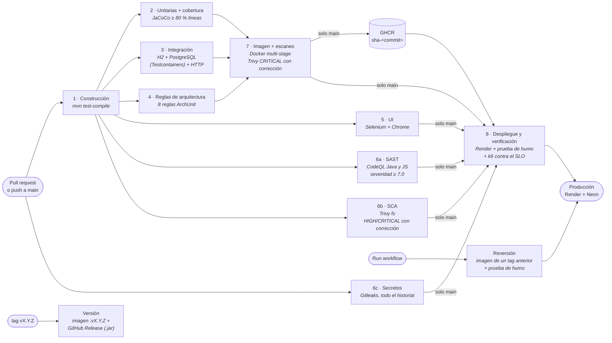
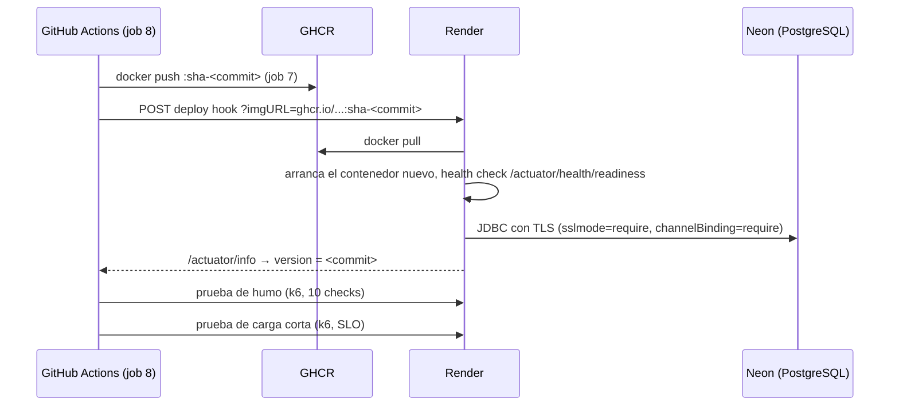

# DevOps — Pipeline de entrega continua de Orderflow Analytics (Corte 3)

Este documento explica qué le pasa a un cambio desde el commit hasta producción: las etapas del
pipeline, el umbral que detiene cada una y por qué se eligió ese valor, cómo se despliega y cómo se
vuelve a la versión anterior. Las decisiones de fondo están en
[ADR-005 (despliegue)](adr/ADR-005-despliegue-render-neon-ghcr.md) y
[ADR-006 (seguridad del pipeline)](adr/ADR-006-seguridad-del-pipeline.md); los controles de
seguridad y sus hallazgos, en [seguridad.md](seguridad.md).

| Workflow | Archivo | Cuándo corre | Qué hace |
|---|---|---|---|
| **Pipeline** | [`ci.yml`](../.github/workflows/ci.yml) | Cada pull request hacia `main` y cada push a `main` (al fusionar) | Construye, prueba, verifica la arquitectura y la seguridad, construye y escanea la imagen; en `main` además publica, despliega y verifica |
| **Versión** | [`release.yml`](../.github/workflows/release.yml) | Al empujar un tag `vX.Y.Z` | Etiqueta en GHCR la imagen ya probada con la versión y crea el GitHub Release con el `.jar` |
| **Reversión** | [`reversion.yml`](../.github/workflows/reversion.yml) | Manual (*Run workflow*) | Vuelve a desplegar la imagen de una versión anterior y la verifica con la prueba de humo |
| **Carga larga** | [`carga-larga.yml`](../.github/workflows/carga-larga.yml) | Manual o cada lunes 6:00 (Colombia) | Prueba de carga larga (flujo de pedidos y analítica) contra producción |
| Dependabot | [`dependabot.yml`](../.github/dependabot.yml) | Semanal | Propone actualizaciones de Maven, Docker, Compose y Actions (cada PR pasa por el mismo pipeline) |

---

## 1. Flujo de trabajo

- **GitHub Flow:** una rama por cambio creada desde `main` → pull request → pipeline en verde +
  aprobación de otro integrante → *merge* → despliegue automático. Nadie hace push directo a `main`.
- **Protección de `main`** (ruleset del repositorio): pull request obligatorio, **1 aprobación de
  otro integrante** (se descarta si llegan commits nuevos), todos los checks del pipeline en verde y
  rama al día con `main`. Los administradores no pueden saltarse la regla.
- **Versionado semántico:** `vMAYOR.MENOR.PARCHE`. Los cambios de cada versión se describen en
  [CHANGELOG.md](../CHANGELOG.md) y en GitHub Releases (las notas se toman del CHANGELOG).

## 2. Diagrama del pipeline



Los jobs 2 a 6 corren **en paralelo** después de la construcción; así la integración continua (sin
despliegue ni carga) tarda **≈ 5–6 minutos**, por debajo del límite de 10 minutos. El caché de
dependencias es el de `actions/setup-java` (`cache: maven`, `~/.m2`) y el de las capas de Docker
(`cache-from/to: type=gha`).

## 3. Etapas, umbrales y por qué

Cada etapa es un *job* de GitHub Actions, aparece como un check en el pull request y puede detener el
pipeline. Todos los reportes se publican como **artefactos** de la ejecución (pestaña *Summary* de la
corrida → *Artifacts*).

| # | Etapa (check) | Qué verifica | Umbral que la detiene | Por qué ese valor | Artefacto |
|---|---|---|---|---|---|
| 1 | Construcción | El código y las pruebas compilan con Java 17; las dependencias se resuelven | No compila | Sin compilación nada más tiene sentido; se separa para fallar en < 1 min | — |
| 2 | Pruebas unitarias y cobertura | Reglas de negocio aisladas: dominio y casos de uso (Corte 2) + propiedades con jqwik | Falla una prueba **o** la cobertura de líneas de `dominio` + `aplicacion` < **80 %** (JaCoCo `check`, rompe `mvn test`) | El enunciado pide ≥ 70 %; el núcleo ya estaba en ≈ 95 % en el Corte 2, así que 80 % **endurece** el mínimo sin volverlo frágil: deja margen para código defensivo difícil de alcanzar y detecta un caso de uso nuevo sin pruebas | `reporte-unitarias-y-cobertura` (Surefire + JaCoCo HTML) |
| 3 | Pruebas de integración | Fronteras de la hexagonal con infraestructura real: adaptadores JDBC con H2 **y con PostgreSQL 18 real (Testcontainers)**, API por HTTP, seguridad (401/403/CSRF) | Falla una prueba | Una prueba verde en H2 no garantiza PostgreSQL (lección del Corte 2); por eso la concurrencia del inventario (40 hilos, 10 huevos) también corre contra PostgreSQL | `reporte-integracion` (Failsafe) |
| 4 | Reglas de arquitectura | 8 funciones de aptitud ArchUnit derivadas de ADR-001/002/006 ([detalle](#4-reglas-de-arquitectura)) | Se viola una regla | Cualquier violación rompe la hexagonal; no hay umbral "parcial" | `reporte-arquitectura` |
| 5 | Pruebas de UI (Selenium) | 5 flujos del POS web con Chrome sin ventana, incluido el inicio de sesión por rol | Falla una prueba | Protege el adaptador web, que las pruebas de API no cubren | `reporte-ui` |
| 6a | SAST (CodeQL Java y JavaScript) | Vulnerabilidades del código propio con la suite `security-extended` | Algún hallazgo con `security-severity` **≥ 7.0** (alto o crítico) sin tratar. Lo evalúa [`umbral_sarif.py`](../.github/scripts/umbral_sarif.py) leyendo el SARIF, porque CodeQL solo reporta | Es el umbral del enunciado ("ningún alto o crítico"); 7.0 es el corte de "alto" en CVSS. Los medios y bajos se revisan y se registran en [seguridad.md](seguridad.md) | `reporte-sast-*` (SARIF) |
| 6b | SCA (Trivy fs) | CVE en las dependencias Maven (incluidas las de prueba) | Alguna vulnerabilidad **HIGH o CRITICAL con corrección disponible** que no esté aceptada con justificación y vencimiento en [`.trivyignore`](../.trivyignore) | Umbral mínimo del enunciado. Las aceptadas vencen (`exp:`) y vuelven a bloquear: no se pueden olvidar | `reporte-sca` |
| 6c | Secretos (Gitleaks) | Contraseñas, tokens y llaves en **todo el historial de Git** (`fetch-depth: 0`) | **Cero** secretos | Un secreto en el historial ya está expuesto aunque se borre del último commit | `reporte-secretos` (SARIF) |
| 7 | Imagen y escaneo (Trivy) | Construye la imagen multi-stage (versión = SHA) y escanea el sistema operativo y el `.jar` | Alguna vulnerabilidad **CRITICAL con corrección disponible** | Umbral del enunciado. Las HIGH de la imagen se ven en el reporte informativo y se tratan en [seguridad.md](seguridad.md); las de las librerías Java ya las bloquea la etapa 6b con HIGH | `reporte-imagen` |
| 8 | Despliegue y verificación *(solo `main`)* | Publica `ghcr.io/<dueño>/orderflow-analytics:sha-<commit>`, la despliega en Render, espera a que `/actuator/info` responda **ese** SHA, corre la prueba de humo y luego la prueba de carga corta | Falla el despliegue (no aparece la versión en 15 min), **falla un solo check de la prueba de humo** o **la carga no cumple el SLO** | Ver la tabla del SLO abajo | `reporte-despliegue` (humo + k6) |

### 3.1 SLO en el pipeline (etapa 8)

El SLO del Corte 2 está escrito como `thresholds` de k6 en
[`perf/scripts/flujo_pedidos_k6.js`](../perf/scripts/flujo_pedidos_k6.js). Después de la prueba de
humo corre el escenario `despliegue` (**5 usuarios virtuales durante 45 s**, cada uno con su sesión):

| Métrica | Umbral (falla si no se cumple) | Origen |
|---|---|---|
| `http_req_duration` p95 (todas) | < 500 ms | SLO del Corte 2 |
| `crear_pedido` p95 | < 500 ms | Reto 1 (descuenta inventario en la misma operación) |
| `avanzar_pedido` p95 · `dividir_cuenta` p95 | < 300 ms | Operaciones simples que el mesero hace de pie junto a la mesa |
| `http_req_failed` | < 1 % | SLO del Corte 2 |
| `checks` | > 99 % | Respuestas correctas, no solo rápidas (la cuenta cuadra al peso, el pedido avanza) |
| `ingredientes_negativos` | == 0 | Reto 1: ninguna venta concurrente deja stock negativo |

¿Por qué 5 usuarios y 45 s? El plan gratuito de Render tiene 0,1 CPU: la prueba corta busca detectar
una **regresión** (una consulta que vuelve a tardar el doble), no medir capacidad. La prueba larga
(10 usuarios, 1 min, flujo de pedidos + analítica) corre en `carga-larga.yml` a mano o los lunes.

**Entorno que se duerme:** el plan gratuito suspende el servicio tras 15 min sin tráfico. Por eso
[`desplegar.sh`](../.github/scripts/desplegar.sh) espera hasta 15 min a que responda la versión
nueva, y los scripts de k6 empiezan con `esperarServicio()` (hasta 180 s de *readiness* en `setup()`)
antes de medir: la latencia de despertar no cuenta en el p95.

## 4. Reglas de arquitectura

[`ArquitecturaTest.java`](../src/test/java/com/restaurant/arquitectura/ArquitecturaTest.java)
(ArchUnit 1.5). Cada regla protege una frontera real de la hexagonal; se comprobó que una clase del
dominio que importa JDBC hace fallar 4 de ellas.

| Regla | Qué impide | ADR |
|---|---|---|
| R1 | Que el dominio dependa de la aplicación o de la infraestructura | ADR-001 |
| R2 | Que los casos de uso dependan de un adaptador | ADR-001 |
| R3 | Que el núcleo (dominio + aplicación) use Spring, Jakarta, JDBC, Swing, H2, PostgreSQL, HikariCP o Jackson | ADR-001 |
| R4 | Que REST o Swing vayan directo a la base de datos saltándose los casos de uso | ADR-001 |
| R5 | Un repositorio JDBC que no implemente un puerto de salida | ADR-001, ADR-002 |
| R6 | Que alguien distinto de la raíz de composición cree los adaptadores de persistencia | ADR-001 |
| R7 | Ciclos entre paquetes | ADR-001 |
| R8 | Usar las piezas de Spring con CVE aceptadas (vistas XSLT, `ModelAndView`, `SseEmitter`) | ADR-006, [H-07](seguridad.md#4-registro-de-hallazgos) |

## 5. Despliegue



- **Imagen:** `ghcr.io/federicovaldez14/orderflow-analytics:sha-<commit>`; con un tag también
  `:vX.Y.Z` (misma imagen, sin reconstruir). **Nunca** se publica ni se despliega `latest`.
- **Render** tiene *Auto-Deploy* apagado: solo despliega cuando el pipeline llama al *deploy hook*
  con la imagen exacta que acaba de pasar todos los controles.
- **Cero tiempo de caída:** Render mantiene la versión anterior atendiendo hasta que la nueva pasa el
  *health check*; si la nueva no arranca, la anterior sigue en línea y el job 8 falla.
- **Secretos** (nunca en el repositorio): `RENDER_DEPLOY_HOOK` y `ORDERFLOW_ADMIN_CLAVE` en el
  *environment* `produccion` de GitHub; la URL pública en la variable `URL_DESPLIEGUE`. La cadena de
  conexión de Neon y las claves solo existen en el panel de Render.
- **Datos iniciales:** al arrancar contra una base vacía, cada adaptador crea su esquema, se cargan la
  carta, los ingredientes y las recetas, y se crea el primer administrador con
  `ORDERFLOW_ADMIN_USUARIO`/`ORDERFLOW_ADMIN_CLAVE` (solo si no existe ninguno).

## 6. Reversión

**Cuándo:** la versión nueva pasó el pipeline pero se descubre un problema en producción (por
ejemplo, un error que las pruebas no cubren). Si el problema lo detecta el propio pipeline no hace
falta revertir: Render sigue con la versión anterior.

**Procedimiento (≈ 3 minutos):**

1. En GitHub: **Actions → Reversión → Run workflow**.
2. En *Versión a la que se vuelve* escribir el tag anterior, por ejemplo `v3.0.0`, y **Run workflow**.
3. El workflow busca el commit del tag, despliega `ghcr.io/…/orderflow-analytics:v3.0.0` con el deploy
   hook, espera a que `/actuator/info` responda el SHA de esa versión y corre la prueba de humo.
4. Verde = producción quedó en la versión anterior y el flujo principal funciona.
5. Corregir el problema con un pull request normal; al fusionarse, el pipeline despliega la corrección.

**Alternativa manual** (si GitHub Actions no está disponible): en Render, **Settings → Image →
Image URL** = `ghcr.io/federicovaldez14/orderflow-analytics:v3.0.0` → *Save* → **Manual Deploy**.

Los datos **no** se revierten: el esquema solo agrega tablas y columnas (`CREATE TABLE IF NOT EXISTS`),
así que una versión anterior funciona con la base de una posterior. Si un cambio futuro modificara el
esquema de forma incompatible, se restaura la copia de seguridad ([implementacion.md §7](implementacion.md#7-operación)).

### 6.1 Registro de la reversión ejecutada

| Fecha | Desde → hacia | Motivo | Ejecución | Resultado |
|---|---|---|---|---|
| *(se completa al ejecutarla)* | | Prueba del procedimiento | | |

## 7. Cómo ejecutar el pipeline

- **Automático:** abrir un pull request hacia `main` (corre las etapas 1–7) o fusionarlo (1–8).
- **A mano:** Actions → Pipeline → *Run workflow* (sobre cualquier rama; despliega solo si es `main`).
- **Publicar una versión:** actualizar `CHANGELOG.md` en un PR; una vez fusionado y con el pipeline de
  `main` en verde:

  ```bash
  git checkout main && git pull
  git tag v3.1.0
  git push origin v3.1.0
  ```

- **En local**, los mismos controles (requiere Docker):

  ```bash
  mvn verify                                   # 1–4
  mvn verify -Pui-tests                        # 5
  docker run --rm -v "$PWD:/repo" -v "$HOME/.m2:/root/.m2:ro" aquasec/trivy:0.76.2 fs --scanners vuln --severity HIGH,CRITICAL --ignore-unfixed --ignorefile /repo/.trivyignore --exit-code 1 /repo/pom.xml
  docker run --rm -v "$PWD:/repo" zricethezav/gitleaks:v8.30.1 git /repo --redact
  k6 run -e ORDERFLOW_CLAVE=<clave-admin> perf/scripts/humo_k6.js
  ```
