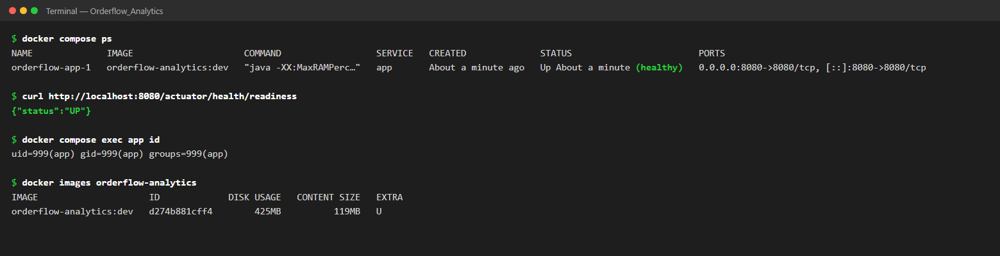
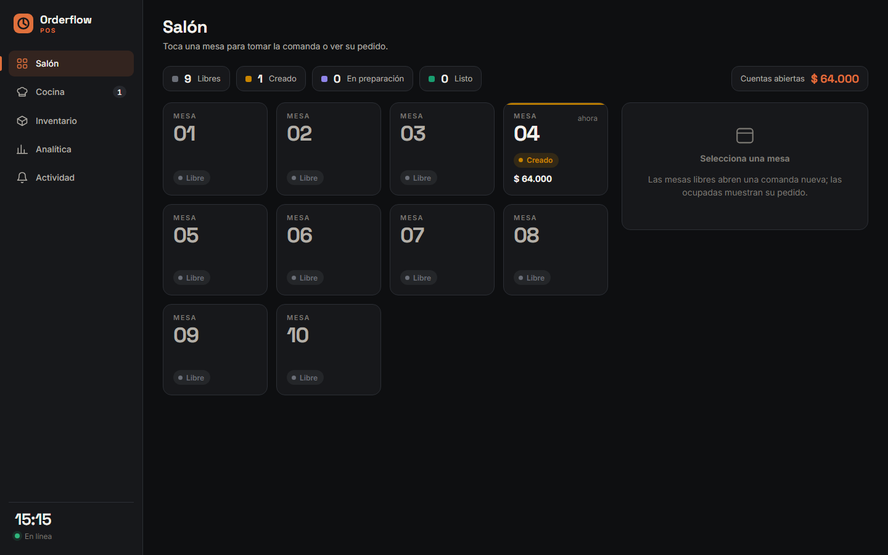

# Contenerización con Docker (Taller de Docker — Parte 4)

La aplicación Spring Boot (Java 17, Maven) se empaqueta en una imagen **multi-stage** y se levanta
con **Docker Compose**. Dentro del contenedor corren la API REST, el POS web
(`http://localhost:8080`) y Actuator; la ventana Swing no, porque un contenedor no tiene pantalla.

| Archivo | Para qué |
|---|---|
| [`Dockerfile`](../Dockerfile) | Imagen multi-stage: compila con Maven + JDK 17 y ejecuta solo con el JRE 17 |
| [`.dockerignore`](../.dockerignore) | Deja fuera del build `target/`, `.git`, `.env`, documentación, pruebas de carga y videos |
| [`docker-compose.yml`](../docker-compose.yml) | Levanta la app con su volumen de datos y variables desde `.env` |
| [`.env.example`](../.env.example) | Plantilla de configuración (se sube); el `.env` real está en `.gitignore` |

## 1. Cómo ejecutarlo

Requisito: Docker Desktop abierto (`docker version` debe mostrar *Server*).

```bash
cp .env.example .env              # en PowerShell también funciona (alias de Copy-Item)
docker compose up -d --build
docker compose ps                 # esperar a que el servicio app diga "healthy"
```

Abrir <http://localhost:8080>. Para detenerlo: `docker compose down` (conserva los datos) o
`docker compose down -v` (borra también el volumen).

Solo la imagen, sin Compose:

```bash
docker build -t orderflow-analytics:dev .
docker run --rm -p 8080:8080 orderflow-analytics:dev
```

Sin variables, la app usa la base H2 en memoria de `application.properties`, así que arranca igual
(los datos se pierden al detener el contenedor).

## 2. Decisiones y buenas prácticas

- **Multi-stage.** La etapa `build` (imagen de Maven con JDK 17) compila el `.jar`; la imagen final
  (`eclipse-temurin` con solo el JRE 17) recibe únicamente ese `.jar`. Maven, el código fuente y las
  dependencias de compilación no llegan a la imagen que se ejecuta, que queda más pequeña y con
  menos superficie de ataque.
- **Versiones fijas completas** (`maven:3.9.16-eclipse-temurin-17-noble`,
  `eclipse-temurin:17.0.20.1_1-jre-noble`), nunca `latest`: el build es reproducible.
- **Caché de capas.** Se copia primero el `pom.xml` y se descargan las dependencias; después `src/`.
  Mientras el `pom.xml` no cambie, esa capa se reutiliza. Además `--mount=type=cache` conserva el
  repositorio local de Maven entre builds.
- **Sin pruebas en el build** (`-Dmaven.test.skip=true`): las 201 pruebas ya corren en el CI
  (`.github/workflows/ci.yml`); el Dockerfile solo empaqueta.
- **Usuario sin privilegios.** La app corre como el usuario de sistema `app`, no como root; si alguien
  la compromete, tiene menos permisos dentro del contenedor.
- **`HEALTHCHECK`** contra `/actuator/health/readiness` (se habilitó con
  `management.endpoint.health.probes.enabled=true`). Docker marca el contenedor `healthy` solo
  cuando Spring Boot terminó de arrancar y la base de datos responde.
- **Configuración por variables de entorno.** La URL, el usuario y la clave de la base llegan desde
  `.env` (`SPRING_DATASOURCE_URL` → `spring.datasource.url`); `${VAR:?mensaje}` hace obligatorias
  las credenciales. Ni el `.env` ni las claves terminan dentro de la imagen (`.dockerignore`).
- **`-XX:MaxRAMPercentage=75`**: la JVM ajusta su heap a la memoria que el contenedor tenga asignada.

## 3. ¿Por qué no hay un servicio de base de datos?

El proyecto usa **H2 embebida** (ADR-002): la base corre dentro del mismo proceso que la aplicación,
no como un servidor aparte. Por eso Compose levanta un solo servicio, y no hay `depends_on` con
condición: no existe otro servicio del que dependa. Lo que sí hace Compose es montar un
**volumen** (`datos-h2`) en `/app/data`, donde se guarda la base en modo archivo
(`jdbc:h2:file:/app/data/orderflow`). Así los pedidos y el inventario sobreviven a
`docker compose down` / `up` y a reinicios del contenedor (`restart: unless-stopped`).

Gracias a la arquitectura hexagonal, pasar a un contenedor de PostgreSQL sería agregar un servicio
`db` con su healthcheck, `depends_on: condition: service_healthy` y otra URL JDBC: cambia el
adaptador de persistencia y la configuración, no el dominio.

## 4. Evidencia

**Contenedor `healthy`, readiness en `UP` y la app corriendo como usuario `app` (uid 999):**



**POS web servido desde el contenedor** (<http://localhost:8080>). El pedido de la mesa 4 se creó,
se ejecutó `docker compose down` y `docker compose up -d`, y siguió ahí: el volumen conserva los datos.



| Comprobación | Resultado |
|---|---|
| `docker build` | Construye; imagen final de **119 MB** de contenido (425 MB en disco), sin Maven ni código fuente |
| Usuario dentro del contenedor | `uid=999(app)`, no root |
| `docker compose ps` | `Up (healthy)` |
| `GET /actuator/health/readiness` | `{"status":"UP"}` |
| Persistencia | El pedido de la mesa 4 sigue después de `down` / `up` (volumen `orderflow_datos-h2`) |
