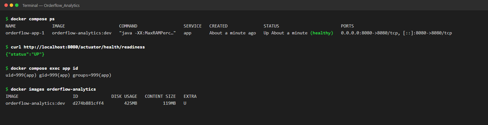
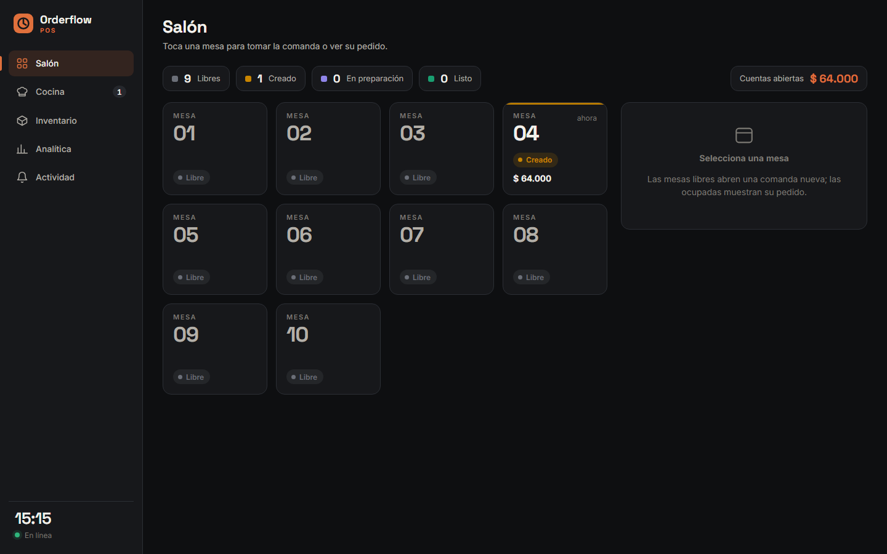

# Contenerización con Docker

> Taller de Docker (Parte 4) ampliado en el Corte 3: PostgreSQL como servicio de Compose,
> contenedor endurecido y observabilidad. Lo que se despliega en producción está en
> [devops.md](devops.md) y en la [vista de despliegue](arquitectura.md#8-vista-de-despliegue-corte-3).

La aplicación Spring Boot (Java 17, Maven) se empaqueta en una imagen **multi-stage** y se levanta
con **Docker Compose**. Dentro del contenedor corren la API REST, el POS web
(`http://localhost:8080`) y Actuator; la ventana Swing no, porque un contenedor no tiene pantalla.

| Archivo | Para qué |
|---|---|
| [`Dockerfile`](../Dockerfile) | Imagen multi-stage: compila con Maven + JDK 17 y ejecuta solo con el JRE 17 |
| [`.dockerignore`](../.dockerignore) | Deja fuera del build `target/`, `.git`, `.env`, documentación, pruebas de carga y videos |
| [`docker-compose.yml`](../docker-compose.yml) | Levanta la app y PostgreSQL 18 (y, con el perfil `observabilidad`, Prometheus y Grafana) con variables desde `.env` |
| [`.env.example`](../.env.example) | Plantilla de configuración (se sube); el `.env` real está en `.gitignore` |

## 1. Cómo ejecutarlo

Requisito: Docker Desktop abierto (`docker version` debe mostrar *Server*).

```bash
cp .env.example .env              # en PowerShell también funciona (alias de Copy-Item)
docker compose up -d --build
docker compose ps                 # esperar a que db y app digan "healthy"
```

Abrir <http://localhost:8080>. Para detenerlo: `docker compose down` (conserva los datos) o
`docker compose down -v` (borra también el volumen).

Solo la imagen, sin Compose:

```bash
docker build -t orderflow-analytics:dev .
docker run --rm -p 8080:8080 orderflow-analytics:dev
```

Sin variables, la app usa la base H2 en memoria de `application.properties`, así que arranca igual
(los datos se pierden al detener el contenedor y el administrador recibe una clave aleatoria que se
muestra en `docker logs`).

## 2. Decisiones y buenas prácticas

- **Multi-stage.** La etapa `build` (imagen de Maven con JDK 17) compila el `.jar`; la imagen final
  (`eclipse-temurin` con solo el JRE 17) recibe únicamente ese `.jar`. Maven, el código fuente y las
  dependencias de compilación no llegan a la imagen que se ejecuta, que queda más pequeña y con
  menos superficie de ataque.
- **Versiones fijas completas** (`maven:3.9.16-eclipse-temurin-17-noble`,
  `eclipse-temurin:17.0.21_9-jre-noble`, `postgres:18.7-alpine`), nunca `latest`: el build es
  reproducible. La imagen base se actualizó en el Corte 3 porque el escaneo de Trivy encontró una
  vulnerabilidad alta en la anterior ([seguridad.md](seguridad.md#4-registro-de-hallazgos), H-05).
- **Caché de capas.** Se copia primero el `pom.xml` y se descargan las dependencias; después `src/`.
  Mientras el `pom.xml` no cambie, esa capa se reutiliza. Además `--mount=type=cache` conserva el
  repositorio local de Maven entre builds.
- **Sin pruebas en el build** (`-Dmaven.test.skip=true`): las pruebas ya corren en las etapas 2 a 5
  del pipeline antes de construir la imagen (`.github/workflows/ci.yml`); el Dockerfile solo
  empaqueta.
- **Versión dentro de la imagen.** `ARG VERSION` → `ENV ORDERFLOW_VERSION`: el pipeline construye con
  `--build-arg VERSION=<commit>` y `/actuator/info` responde qué versión está corriendo.
- **Usuario sin privilegios.** La app corre como el usuario de sistema `app`, no como root; si alguien
  la compromete, tiene menos permisos dentro del contenedor.
- **`HEALTHCHECK`** contra `/actuator/health/readiness` (se habilitó con
  `management.endpoint.health.probes.enabled=true`). Docker marca el contenedor `healthy` cuando
  Spring Boot terminó de arrancar y está listo para recibir peticiones. A diferencia de
  `/actuator/health`, el readiness no incluye la base de datos: si la base falla un momento, Docker no
  reinicia la aplicación sin necesidad.
- **Configuración por variables de entorno.** La URL, el usuario y la clave de la base llegan desde
  `.env` (`SPRING_DATASOURCE_URL` → `spring.datasource.url`); `${VAR:?mensaje}` hace obligatorias
  las credenciales. Ni el `.env` ni las claves terminan dentro de la imagen (`.dockerignore`).
- **`-XX:MaxRAMPercentage=75`**: la JVM ajusta su heap a la memoria que el contenedor tenga asignada.

## 3. PostgreSQL como servicio de Compose (Corte 3)

En el taller la base era H2 embebida dentro del proceso, así que Compose tenía un solo servicio. En
el Corte 3 la base pasó a **PostgreSQL 18** ([ADR-005](adr/ADR-005-despliegue-render-neon-ghcr.md)),
como estaba previsto: gracias a la hexagonal solo cambiaron la configuración y el adaptador JDBC
(la sintaxis de la secuencia), no el dominio.

- **Servicio `db`** (`postgres:18.7-alpine`) con volumen `datos-db` y **healthcheck**
  `pg_isready`. No publica puertos: solo la aplicación lo alcanza, por la red interna de Compose.
- **`depends_on: db: condition: service_healthy`**: la aplicación arranca cuando PostgreSQL ya acepta
  conexiones, no solo cuando el contenedor existe.
- **Contenedor de la app endurecido:** `read_only: true` (Tomcat escribe solo en un `tmpfs` en
  `/tmp`), `cap_drop: ALL`, `no-new-privileges` y `mem_limit: 768m`.
- **Perfil `observabilidad`:** `docker compose --profile observabilidad up -d` agrega Prometheus
  (recolecta `/actuator/prometheus` con el usuario de solo lectura `MONITOR`; la clave llega como
  *secret* de Compose) y Grafana con el tablero del SLO ya provisionado. Ambos escuchan solo en
  `127.0.0.1`.

## 4. Evidencia (taller, con H2)

**Contenedor `healthy`, readiness en `UP` y la app corriendo como usuario `app` (uid 999):**



**POS web servido desde el contenedor** (<http://localhost:8080>). El pedido de la mesa 4 se creó,
se ejecutó `docker compose down` y `docker compose up -d`, y siguió ahí: el volumen conserva los datos.



| Comprobación | Resultado |
|---|---|
| `docker build` | Construye; imagen final de **119 MB** de contenido (425 MB en disco), sin Maven ni código fuente |
| Usuario dentro del contenedor | `uid=999(app)`, no root |
| `docker compose ps` | `Up (healthy)` |
| `GET /actuator/health/readiness` | `{"status":"UP"}` |
| Persistencia | El pedido de la mesa 4 sigue después de `down` / `up` (volumen `orderflow_datos-h2`) |
