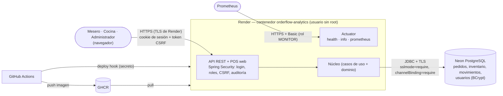

# Seguridad — Modelo de amenazas, controles y registro de hallazgos (Corte 3)

La seguridad se trata igual que el rendimiento: un objetivo explícito y una verificación automática en
el pipeline. Herramientas y umbrales: [ADR-006](adr/ADR-006-seguridad-del-pipeline.md); cómo corren
en el pipeline: [devops.md §3](devops.md#3-etapas-umbrales-y-por-qué).

**Repositorio:** <https://github.com/federicovaldez14/Orderflow_Analytics>

---

## 1. Superficie del sistema

Sobre el [diagrama de contenedores](arquitectura.md#43-diagrama-de-contenedores-c4-nivel-2) y la
[vista de despliegue](arquitectura.md#8-vista-de-despliegue-corte-3):

**Fronteras de confianza:** (1) navegador ↔ API (Internet); (2) contenedor ↔ base de datos
(red del proveedor); (3) GitHub ↔ Render (cadena de suministro: código, dependencias, imagen,
secretos del despliegue).

**Usuarios y roles** (Spring Security, usuarios en la tabla `users` con BCrypt):

| Rol | Puede | No puede |
|---|---|---|
| `ADMIN` | Todo: usuarios, inventario (reposición y ajuste), analítica, pedidos, métricas | — |
| `MESERO` | Tomar, editar, cancelar, avanzar y dividir pedidos; consultar | Inventario, analítica, usuarios |
| `COCINA` | Consultar pedidos y **avanzarlos** (preparación → listo) | Crear, editar o cancelar pedidos; inventario; usuarios |
| `MONITOR` | Solo `GET /actuator/prometheus` (usuario de Prometheus) | Toda la API |

Rutas públicas: archivos estáticos de la web, `/actuator/health/**`, `/actuator/info` (nombre y
versión, sin datos internos) y `/api/sesion/**` (login, logout y consultar la sesión). **Todo lo
demás se niega por defecto** (`denyAll`).

## 2. Modelo de amenazas (STRIDE)

| # | Amenaza | STRIDE | Componente o flujo | Mitigación | Cómo se verifica |
|---|---|---|---|---|---|
| A1 | Alguien sin cuenta usa la API desde Internet para crear pedidos falsos y descontar inventario (la URL de Render es pública) | **S**uplantación | Navegador → API REST (`/api/pedidos`, `/api/inventario`) | **Autenticación** obligatoria en toda `/api/**` salvo `/api/sesion`: formulario de login con sesión (cookie `HttpOnly`, `SameSite=Strict`, `Secure` en producción) o HTTP Basic para scripts; contraseñas con **BCrypt**; respuesta 401 sin pistas | `SeguridadIT.shouldRejectAnonymousRequests` y `shouldRejectWrongPassword` (etapa 3); prueba de humo (inicia sesión antes de operar) |
| A2 | Un mesero ajusta el inventario para ocultar un faltante, o la cocina cancela pedidos | **E**levación de privilegios | API → `ServicioInventario` (`POST /api/inventario/{codigo}/ajuste`) y `GestorPedidos` (`/cancelar`) | **Autorización por rol**: inventario y analítica solo `ADMIN`; cocina solo puede avanzar; reglas en `ConfiguracionSeguridad` con negación por defecto | `SeguridadIT.shouldRestrictInventoryAndAnalyticsToAdmin` y `shouldLetKitchenOnlyAdvanceOrders` esperan **403** (etapa 3); `PosWebUiIT` flujo 5: la cocina solo ve *Cocina* y *Actividad* (etapa 5) |
| A3 | Una página maliciosa abierta en la tablet del mesero envía `POST /api/pedidos/{id}/cancelar` aprovechando la sesión iniciada | **T**ampering (manipulación) — CSRF | Navegador → API (peticiones que cambian datos) | Token **CSRF** por sesión (cookie `XSRF-TOKEN` + cabecera `X-XSRF-TOKEN`, comparación con XOR) y cookie `SameSite=Strict`; la API rechaza con 403 si falta | `SeguridadIT.shouldRequireCsrfTokenForBrowserSessions` (etapa 3); la prueba de humo y k6 usan el token real |
| A4 | Un empleado niega haber hecho un ajuste de inventario o una cancelación; o falsifica líneas del log enviando saltos de línea en la ruta | **R**epudio | API → log de auditoría (`FiltroAuditoria`) | Toda petición que cambia datos se registra con usuario, método, ruta y código de respuesta (logger `AUDITORIA`); los valores se escriben **sin saltos de línea** (CWE-117); además, cada movimiento de inventario queda en `movimiento_inventario` | `FiltroAuditoriaTest` (etapa 2); CodeQL `java/log-injection` (etapa 6a, hallazgo H-09 corregido) |
| A5 | Un atacante lee `/actuator/env` o `/actuator/heapdump` y obtiene la contraseña de la base; o un error 500 devuelve la traza con nombres de clases y SQL | **I**nformación (divulgación) | Internet → Actuator y manejo de errores de Spring Boot | Solo se exponen `health`, `info`, `metrics` y `prometheus`; `metrics`/`prometheus` requieren `MONITOR` o `ADMIN`; detalles del health solo para `ADMIN`; `server.error.include-stacktrace=never` e `include-message=never` | `SeguridadIT.shouldProtectMetricsButNotHealth` (etapa 3) |
| A6 | Se interceptan en la red las credenciales o los datos entre Render y Neon; un intermediario fuerza una autenticación más débil | **I**nformación / **S**uplantación | Contenedor → Neon PostgreSQL (JDBC) | TLS obligatorio (`sslmode=require`) y **channel binding** (`channelBinding=require`, SCRAM-SHA-256-PLUS); pgjdbc **42.7.14**, que corrige CVE-2026-54291 (degradación de SCRAM-PLUS) | SCA (etapa 6b) bloquea un pgjdbc vulnerable; la conexión falla si el servidor no ofrece TLS |
| A7 | 30 personas abren la analítica a la vez y el servicio se cae por memoria (pasó en el Corte 2 con ≈ 47.000 pedidos) | **D**enegación de servicio | API → `ServicioAnalitica` (`GET /api/analitica`) | Filtro por fecha en SQL, caché de 3 s y **un solo cálculo a la vez**; analítica solo para `ADMIN` (menos usuarios concurrentes); pool de conexiones acotado | `ServicioAnaliticaTest` (20 usuarios → 1 cálculo, etapa 2); `analitica_k6.js` con umbral p95 en `carga-larga.yml` |
| A8 | Se publica una contraseña o un token en el repositorio (por ejemplo, la cadena de Neon en un `application.properties`) | **I**nformación | Desarrollador → repositorio Git | Configuración solo por variables de entorno (`.env` ignorado por git, `.env.example` con valores de ejemplo); secretos del despliegue en GitHub Secrets / panel de Render | **Gitleaks** sobre todo el historial (etapa 6c); PR bloqueado de prueba ([§5](#5-evidencia-pull-request-bloqueado)) |
| A9 | Una dependencia o la imagen base trae una vulnerabilidad conocida explotable (cadena de suministro) | **T**ampering / **E**levación | GitHub → GHCR → Render (imagen) | SCA de dependencias y escaneo de la imagen como *quality gates*; versiones fijas de imagen base y herramientas; Dependabot semanal; proceso sin root, sistema de archivos de solo lectura y sin capacidades de Linux en Compose | Trivy fs (6b) y Trivy image (7) |
| A10 | Quien obtenga el *deploy hook* despliega una imagen arbitraria en producción | **E**levación / **T**ampering | GitHub Actions → Render (deploy hook) | El hook es un secreto del *environment* `produccion`; Auto-Deploy apagado; el pipeline verifica que la versión desplegada sea el SHA esperado (`/actuator/info`); si se filtra, se regenera en Render | Job 8 falla si `/actuator/info` no responde el SHA del commit |

## 3. Controles del pipeline (quality gates)

| Control | Herramienta (versión fija) | Etapa | Umbral del enunciado | Umbral aplicado | Endurecimiento |
|---|---|---|---|---|---|
| SAST | CodeQL `security-extended` (Java y JavaScript) + [`umbral_sarif.py`](../.github/scripts/umbral_sarif.py) | 6a | Ningún alto o crítico sin tratar | `security-severity` ≥ 7.0 → falla | Suite `security-extended` (más reglas que la por defecto) y también el JavaScript del POS web |
| SCA | Trivy 0.76.2 `fs` sobre `pom.xml` | 6b | Ninguna alta o crítica con corrección | HIGH/CRITICAL con corrección → falla | Incluye dependencias de prueba; las aceptaciones **vencen** (`exp:`) |
| Secretos | Gitleaks 8.30.1 `git` | 6c | Cero, incluido el historial | Cero, `fetch-depth: 0` | Corre también en ramas de Dependabot |
| Imagen | Trivy 0.76.2 `image` | 7 | Ninguna crítica con corrección | CRITICAL con corrección → falla | Reporte completo (todas las severidades) como artefacto |

Excepciones: solo en [`.trivyignore`](../.trivyignore), cada una con justificación, **fecha de
vencimiento** y su fila en el registro de abajo. No hay reglas de CodeQL deshabilitadas ni
supresiones en el código.

## 4. Registro de hallazgos

Decisiones posibles: **corregido** (enlace al commit), **falso positivo** (justificación técnica) o
**riesgo aceptado** (justificación y qué haría falta para corregirlo).

| ID | Control | Hallazgo | Severidad | Decisión | Detalle |
|---|---|---|---|---|---|
| H-01 | SCA | Spring Boot 2.7.18 (sin soporte): 20 CVE altas y críticas en Spring Framework, Spring Security, Tomcat, Jackson y SnakeYAML | HIGH/CRITICAL | **Corregido** | Migración a Spring Boot 3.5 ([0d11fae](https://github.com/federicovaldez14/Orderflow_Analytics/commit/0d11fae)) |
| H-02 | SCA | Tomcat embebido 10.1.55 (el de Boot 3.5.16): CVE críticas y altas, corregidas en 10.1.59+ | CRITICAL | **Corregido** | Fijado Tomcat 10.1.62 en `dependencyManagement` ([2df216c](https://github.com/federicovaldez14/Orderflow_Analytics/commit/2df216c)) |
| H-03 | SCA | Jackson 2.21.4: CVE alta corregida en 2.21.7+ | HIGH | **Corregido** | `jackson-bom` 2.21.8 ([2df216c](https://github.com/federicovaldez14/Orderflow_Analytics/commit/2df216c)) |
| H-04 | SCA | pgjdbc 42.7.11: CVE-2026-54291, un intermediario puede degradar SCRAM-SHA-256-PLUS (amenaza A6) | HIGH | **Corregido** | pgjdbc 42.7.14 ([2df216c](https://github.com/federicovaldez14/Orderflow_Analytics/commit/2df216c)) |
| H-05 | Imagen | Imagen base `eclipse-temurin:17.0.20.1_1-jre-noble`: paquete del sistema con CVE alta | HIGH | **Corregido** | Base `17.0.21_9-jre-noble`; hoy 0 HIGH/CRITICAL del sistema operativo ([2df216c](https://github.com/federicovaldez14/Orderflow_Analytics/commit/2df216c)) |
| H-06 | SAST | `java/comparison-with-wider-type` en `Repartidor.java:55`: el bucle compara un `int` con un `long` (bucle infinito si el `long` supera `Integer.MAX_VALUE`) | 8.1 (alto) | **Corregido** | En la práctica el sobrante es < número de personas, pero se corrigió con `Math.toIntExact` (falla en vez de colgarse) ([d12865b](https://github.com/federicovaldez14/Orderflow_Analytics/commit/d12865b)) |
| H-07 | SCA + Imagen | Spring Framework 6.2.19 (`spring-webmvc`): **CVE-2026-47884** (ejecución remota vía `XsltView`) y **CVE-2026-47890** (corrupción de flujos SSE con vistas) | CRITICAL | **Riesgo aceptado** hasta el 2027-02-28 | No hay parche para la rama 6.2 (la corrección es Spring 7.0.9 = Spring Boot 4). **No aplica:** la API es JSON pura; no usa vistas, `XsltView`, `ModelAndView` ni `SseEmitter`. **Control compensatorio:** la regla ArchUnit **R8** rompe el build si alguien empieza a usarlos. **Para corregirlo:** migrar a Spring Boot 4 (Jakarta EE 11, Jackson 3, cambios en paquetes de pruebas), planeado para el siguiente ciclo. La excepción vence en `.trivyignore` y vuelve a bloquear el pipeline |
| H-08 | Secretos | Gitleaks sobre todo el historial (31 confirmaciones al cierre del Corte 3) | — | Sin hallazgos | Las claves de prueba (`clave-solo-pruebas-1`, `clave-local-*`) no coinciden con patrones de secretos y no dan acceso a ningún entorno real |
| H-09 | SAST | `java/log-injection` en `FiltroAuditoria.java:33`: el usuario y el método llegaban al log sin limpiar | medio | **Corregido** | Todos los valores pasan por `sinSaltos()`; prueba `FiltroAuditoriaTest` ([3530172](https://github.com/federicovaldez14/Orderflow_Analytics/commit/3530172)) |

## 5. Evidencia: pull request bloqueado

Pull request que introduce **a propósito** una llave falsa en un archivo de configuración para
comprobar que el control de secretos detiene el pipeline. Se cierra **sin fusionar**.

| Pull request | Qué introduce | Control que lo bloquea | Estado |
|---|---|---|---|
| [#18](https://github.com/federicovaldez14/Orderflow_Analytics/pull/18) · *[Prueba DevSecOps] Llave de API en un archivo de configuración* | `src/main/resources/application-pagos.properties` con `pasarela.api-key=` y 40 caracteres aleatorios (no corresponden a ningún servicio) | **6c · Secretos (Gitleaks, todo el historial)**: regla `generic-api-key` en la línea 3 (commit `68191ab`). Es un check obligatorio de la protección de `main`, así que GitHub marcó el PR como `BLOCKED` | Cerrado **sin fusionar** y con la rama borrada (16/11/2026). [Ejecución del pipeline](https://github.com/federicovaldez14/Orderflow_Analytics/actions/runs/43937492788) |

Las demás etapas del mismo pipeline pasaron (construcción, pruebas, CodeQL, Trivy, imagen): el
bloqueo se debe **solo** al secreto. La llave nunca llegó a `main`, así que el escaneo de todo el
historial en `main` sigue sin hallazgos (H-08).

Otros dos casos en que el pipeline detuvo un cambio real (no preparado):

| Commit | Qué detectó | Etapa | Cómo se resolvió |
|---|---|---|---|
| `4db7466` (PR #1) | CodeQL: comparación `int`/`long` en `Repartidor` (H-06) | 6a · SAST | Corregido en `d12865b` |
| `6cae416` (primer despliegue a `main`) | Prueba de carga corta: p95 de `crear_pedido` 1.303 ms > 500 ms | 8 · Despliegue | Escenario ajustado a la demanda real, sin cambiar los umbrales ([devops.md §3.1](devops.md#31-slo-en-el-pipeline-etapa-8)) |

## 6. Otras medidas (fuera del pipeline)

- **Cabeceras HTTP:** `Content-Security-Policy` (scripts y datos solo del propio sitio, sin scripts
  en línea; únicamente las fuentes tipográficas vienen de Google Fonts; `frame-ancestors 'none'`),
  `X-Content-Type-Options`, `X-Frame-Options: DENY`, `Referrer-Policy: same-origin` y HSTS detrás
  de HTTPS.
- **Sesión:** 8 h de duración (un turno), cookie `HttpOnly` + `SameSite=Strict` + `Secure`
  (`ORDERFLOW_COOKIE_SEGURA=true` en producción); al cerrar sesión se invalida en el servidor.
- **Primer administrador:** se crea desde variables de entorno (mínimo 12 caracteres); si no se
  define, se genera una clave aleatoria y se muestra una sola vez en el log. Nunca hay una clave por
  defecto en el código.
- **Contenedor:** usuario sin privilegios (`app`), imagen JRE (sin compilador ni Maven); en Compose,
  sistema de archivos de solo lectura, `cap_drop: ALL`, `no-new-privileges` y límite de memoria; la
  base de datos no publica puertos.
- **Observabilidad:** Prometheus consulta con un usuario `MONITOR` de solo lectura y su clave llega
  como *secret* de Compose (archivo), no como variable visible en `docker inspect`; Grafana y
  Prometheus solo escuchan en `127.0.0.1`.

## 7. Riesgos abiertos

| Riesgo | Por qué sigue abierto | Qué haría falta |
|---|---|---|
| H-07: Spring 6.2 sin parche | Requiere migrar a Spring Boot 4 | Migración planeada; mientras tanto R8 impide usar las piezas afectadas |
| Sin límite de intentos de login | Fuera del alcance del corte | Bloqueo temporal por usuario/IP (por ejemplo, Bucket4j) o un proveedor de identidad |
| Log de auditoría en la salida estándar del contenedor | Render guarda los logs por tiempo limitado en el plan gratuito | Enviar el logger `AUDITORIA` a un almacenamiento centralizado y de solo escritura (Loki, ELK) |
| Sin análisis dinámico (DAST) | Se eligió la bonificación de observabilidad | OWASP ZAP *baseline* contra el entorno desplegado |
